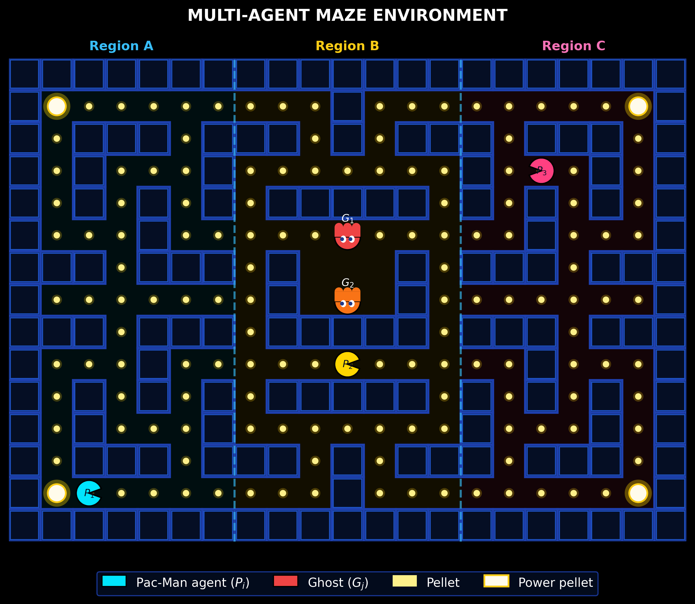
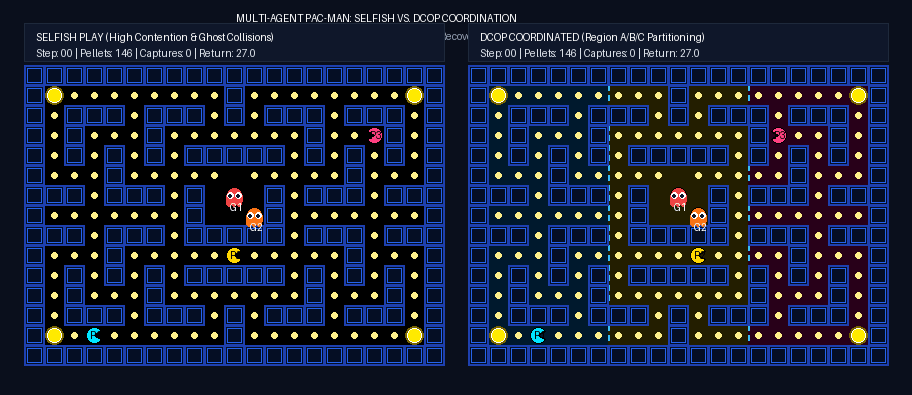
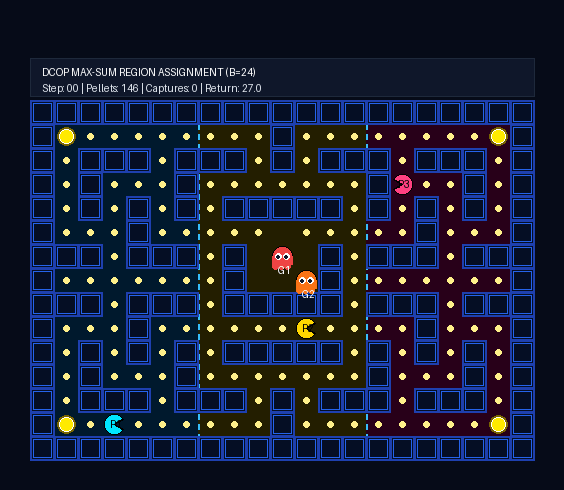
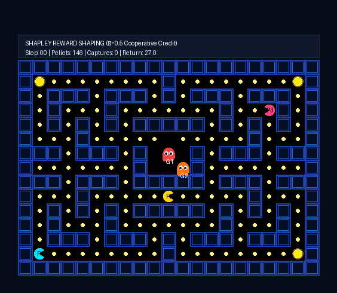

# Multi-Agent Pac-Man Testbed: Measuring and Recovering the Price of Anarchy

[](https://www.python.org/downloads/)
[](https://opensource.org/licenses/MIT)
[](https://iitgn.ac.in)
[]()
[](https://tanujsharma2712.github.io/multi-agent-pacman-poa/)

> **CS329: Multi-Agent Systems — Final Project Report & Testbed**  
> **Indian Institute of Technology Gandhinagar (IITGN)**  
> **Authors:**
> - **Tanuj Sharma** (23110331) — `tanuj.sharma@iitgn.ac.in`
> - **Rajput Vivek** (23110269) — `rajput.vivek@iitgn.ac.in`
> - **Akash KP** (23110021) — `akash.kp@iitgn.ac.in`  
> *(Note: Dhruv Jalan's originally planned work on Shapley value credit assignment, reward shaping, and fairness evaluation was fully absorbed and implemented by Tanuj Sharma, while Akash KP led DCOP coordination and Vivek Rajput led baseline & centralized planning).*

---

> [!IMPORTANT]
> ### 🕹️ TEST & PLAY THE GAME DIRECTLY (Interactive Simulator & Playable Arcade)
> **You can test and play this multi-agent game right now with zero friction!**
> 
> * **🌐 Option A: Instant Web Arcade (Anyone Can Play With This Link!)**  
>   **👉 Direct Live Link: [https://tanujsharma2712.github.io/multi-agent-pacman-poa/](https://tanujsharma2712.github.io/multi-agent-pacman-poa/)**  
>   *(Zero setup required: works in any web browser on desktop, laptop, tablet, or smartphone! You can also double-click [**`index.html`**](index.html) or [**`play.html`**](play.html) locally).*
> 
> * **🖥️ Option B: Desktop Python GUI (75% Arcade Board / 25% Control Station)**  
>   Run the native Python Tkinter desktop application (zero external pip packages required):  
>   ```bash
>   python play_game.py
>   ```
> 
> **How to Test & Interact:**
> | Feature | How to Use | What Happens |
> | :--- | :--- | :--- |
> | **🎮 Play as P1 (Human)** | Select **`[●] 🎮 Human Player`** mode | You steer Pac-Man 1 ($P_1$, Cyan with "YOU" tag) using **Arrow Keys**, **WASD**, or the on-screen **D-Pad** (`▲`, `◄`, `⏹`, `►`, `▼`). |
> | **🤝 Pick AI Teammates** | Choose from the Teammates dropdown | $P_2, P_3$ dynamically coordinate alongside you via **DCOP Max-Sum**, **DCOP DSA**, **Shapley Q-Learning**, or **Selfish Greedy**. |
> | **🤖 Autonomous Watch** | Select **`[●] 🤖 Autonomous AI`** mode | "YOU" tag disappears; all agents coordinate autonomously under the selected multi-agent joint algorithm. |
> | **🧪 Live Experimentation** | Use the **Experimental Controls** panel | Adjust Team Size $k \in [2, 5]$, Ghosts $M \in [0, 4]$, Ghost Aggression $\beta$, DCOP Budget $B$, and Shapley $\lambda$, then click **`⚙ Apply Scenario Settings`** to test any experimental condition live! |
> | **📊 Real-Time HUD** | Watch the top statistics bar | Tracks Score, Pellets remaining, Captures, Steps, live **Price of Anarchy ($\mathrm{PoA}$)**, and **Gini Fairness Index** on every step. |

---

## 📌 Table of Contents
1. [Executive Summary](#-executive-summary)
2. [🎮 Playable Game & Autonomous Watch Modes](#-playable-game--autonomous-watch-modes)
3. [🕹 Retro Arcade Environment & Spatial Partitioning](#-retro-arcade-environment--spatial-partitioning)
4. [🎬 Gameplay Animations & Coordination Visuals](#-gameplay-animations--coordination-visuals)
5. [📊 Benchmark Summary Table](#-benchmark-summary-table)
6. [Mathematical Formulation](#-mathematical-formulation)
   - [Game Mechanics & Contention](#game-mechanics--contention)
   - [Price of Anarchy (PoA)](#price-of-anarchy-poa)
   - [Remedy 1: DCOP-Based Region Assignment](#remedy-1-dcop-based-region-assignment)
   - [Remedy 2: Shapley-Value Reward Shaping](#remedy-2-shapley-value-reward-shaping)
7. [📈 Experimental Results & Hypothesis Verification](#-experimental-results--hypothesis-verification)
   - [Experiment 1: Team Size $k$ & Ghost Aggression $\beta$ vs. PoA](#experiment-1-team-size-k--ghost-aggression-beta-vs-poa)
   - [Experiment 2: DCOP Message Budget Recovery (DSA vs. Max-Sum)](#experiment-2-dcop-message-budget-recovery-dsa-vs-max-sum)
   - [Experiment 3: Shapley Shaping Parameter $\lambda$ & Gini Fairness](#experiment-3-shapley-shaping-parameter-lambda--gini-fairness)
   - [Experiment 4: Comprehensive Multi-Method Benchmark](#experiment-4-comprehensive-multi-method-benchmark)
8. [📁 Project Architecture & File Organization](#-project-architecture--file-organization)
9. [⚙️ Installation & Reproducibility Guide](#️-installation--reproducibility-guide)
10. [👥 Member Contributions](#-member-contributions)
11. [📚 References](#-references)

---

## 🚀 Executive Summary

When multiple autonomous agents share a common environment with scarce resources, uncoordinated selfish behavior induces severe coordination pathologies: duplicated traversal, contention over identical resources, and failure to take collective risks. We quantify this loss using the game-theoretic **Price of Anarchy ($\mathrm{PoA}$)** in a multi-agent Pac-Man simulation environment where $k$ Pac-Men harvest a shared pool of pellets while evading dangerous ghosts.

We rigorously formulate, implement, and benchmark two contrasting coordination paradigms to recover the selfish performance gap:
1. **Communication-Based Coordination (DCOP)**: Real-time decentralized spatial partitioning via **Max-Sum** (min-marginal belief propagation over factor graphs) and **DSA** (Distributed Stochastic Algorithm) under strictly bounded per-step message budgets $B$.
2. **Incentive-Based Learning (Shapley Value)**: Game-theoretic cooperative credit assignment in Multi-Agent Reinforcement Learning (MARL) via counterfactual marginal contributions $\varphi_i$, resolving the classic multi-agent "free-rider" pathology without runtime communication overhead.

---

## 🎮 Playable Game & Autonomous Watch Modes

You can run and play this game interactively or watch the AI algorithms coordinate in real time using either the **Desktop GUI** or the **Web Browser Arcade Game**:

### 1. Desktop Python GUI Game (`play_game.py`)
Built with Python's standard `tkinter` library — **zero extra pip packages required**:

```bash
python play_game.py
```

- **Adaptive 75% Board / 25% Control Station**:
  - **75% Board Canvas**: Large, arcade-sized maze with dynamic screen-scaling so the board expands and remains crisp on any monitor resolution.
  - **25% Operating Station**: Houses execution controls, on-screen D-Pad, and live experimental scenario controls.
- **Two Primary Play Modes**:
  - **`[●] 🎮 Human Player (You Control P1)`**:
    - Steer Pac-Man 1 ($P_1$, glowing Cyan with "YOU" tag) using **Arrow Keys**, **W, A, S, D**, or click the on-screen **D-Pad** (`▲`, `◄`, `⏹`, `►`, `▼`).
    - Teammates ($P_2, P_3, \ldots$) coordinate alongside you via your choice of DCOP Max-Sum, DCOP DSA, Shapley Q-Learning, Equal-Share, or Selfish Greedy.
  - **`[●] 🤖 Autonomous AI (Watch Full Team)`**:
    - "YOU" tag disappears; all agents coordinate autonomously under the selected multi-agent joint algorithm.
- **🧪 Live Experimental Testbed Panel**:
  - Directly test conditions from Experiments 1–4 by tweaking:
    - **Maze Layout**: `proposal_maze` (21×15), `medium_classic`, `open_contention`, `small_grid`.
    - **Team Size ($k$)**: 2, 3, 4, or 5 Pac-Men.
    - **Ghost Count ($M$) & Hazard ($\beta$)**: 0 to 4 ghosts; aggression parameter $\beta \in [0.0, 1.0]$.
    - **DCOP Budget ($B$)**: 0 to 48 messages per step.
    - **Shapley Weight ($\lambda$)**: $0.0$ (Selfish) to $1.0$ (Pure Shapley).
    - Click **`⚙ Apply Scenario Settings`** to immediately reload and test the customized scenario!
- **Live Scientific HUD**: Real-time Score, Pellets remaining, Ghost Captures, Step counter, Gini Inequality Index, and live Price of Anarchy ($\mathrm{PoA}$).

### 2. Standalone Web Browser Game (`play.html`)
- Open [**`play.html`**](play.html) directly in any web browser (Chrome, Edge, Firefox, Safari).
- Built with HTML5 Canvas, zero external dependencies, retro CRT glow styling, clickable on-screen D-Pad, keyboard controls, real-time metrics HUD, and the full experimental scenario configuration panel.
- Can be tested locally or hosted instantly via GitHub Pages.

---

## 🕹 Retro Arcade Environment & Spatial Partitioning

<p align="center">
  
  <br>
  <em>Figure 1: Authentic Retro Arcade Simulation Environment matching Figure 1 of the Project Proposal. The 21×15 maze features 3 balanced vertical sectors (Region A, Region B, Region C) with dashed partition boundaries, 3 Pac-Men ($P_1, P_2, P_3$), 2 Ghosts ($G_1, G_2$), standard food pellets, and 4 corner power pellets.</em>
</p>

### Environmental Characteristics
- **Graph Representation**: Undirected connected graph $G = (V, E)$ with 154 traversable open cells.
- **Regions for DCOP**:
  - **Region A ($R_1$)**: Columns $1 \le x \le 6$ (48 open cells, West sector).
  - **Region B ($R_2$)**: Columns $7 \le x \le 13$ (58 open cells, Central sector with ghost house).
  - **Region C ($R_3$)**: Columns $14 \le x \le 19$ (48 open cells, East sector).
- **Contention Mechanics**: When multiple Pac-Men enter the same pellet cell simultaneously, exactly one agent is chosen uniformly at random to receive the $+10$ reward, while the others expend their action with zero gain.
- **Ghost Danger**: Ghosts pursue the nearest Pac-Man along shortest graph paths with probability $\beta$, penalizing caught Pac-Men $-50$ and respawning them at base.

---

## 🎬 Gameplay Animations & Coordination Visuals

To visually demonstrate the emergence of the Price of Anarchy and its recovery, we provide generated animated simulation recordings:

### Side-by-Side: Selfish Play vs. DCOP Coordinated Play
<p align="center">
  
  <br>
  <em>Figure 2: Animated side-by-side gameplay comparison. <b>Left:</b> Purely Selfish Play leads to severe contention over central pellets, wasted steps, and frequent ghost captures. <b>Right:</b> DCOP Max-Sum deconfliction partitions agents into Region A, B, and C, enabling parallel pellet harvesting with zero redundant collisions.</em>
</p>

### DCOP Coordinated Max-Sum & Shapley Q-Learning Gameplay
<p align="center">
  
  &nbsp;&nbsp;
  
  <br>
  <em>Figure 3: High-framerate animations. <b>Left:</b> DCOP Max-Sum agents executing synchronized region-sweeping policies. <b>Right:</b> Cooperative Shapley-shaped Q-learning agents deconflicting paths and sharing pellets equitably.</em>
</p>

---

## 📊 Benchmark Summary Table

The table below presents the quantitative evaluation across all 8 baselines and remedies on the 21×15 benchmark environment (25 evaluation episodes per configuration, 95% confidence intervals):

| Method | Paradigm | Expected Return $J(\pi)$ | 95% Conf. Interval | Price of Anarchy ($\mathrm{PoA}$) | Selfish Gap Recovered | Fairness (Gini Index) | Ghost Captures | Steps to Clear |
| :--- | :---: | :---: | :---: | :---: | :---: | :---: | :---: | :---: |
| **Random Baseline** | Uncoordinated | $-1161.1$ | $\pm 191.1$ | $1.000^\dagger$ | $0.0\%$ | $0.414$ | $46.05$ | $100.0$ |
| **Selfish Q-Learning ($\lambda=0$)** | Independent MARL | $664.4$ | $\pm 29.1$ | **$1.376$** | **$0.0\%$ (Ref)** | $0.359$ | $1.95$ | $100.0$ |
| **Independent Greedy** | Local Heuristic | $861.5$ | $\pm 31.9$ | $1.061$ | $79.0\%$ | $0.090$ | $0.85$ | $93.9$ |
| **Equal-Share Q-Learning** | Naive Sharing | $852.2$ | $\pm 30.9$ | $1.073$ | $75.2\%$ | $0.102$ | $2.40$ | $91.4$ |
| **DCOP-DSA ($B=12$)** | Communication | $732.2$ | $\pm 41.0$ | $1.248$ | **$27.2\%$** | $0.096$ | **$0.95$** | $99.9$ |
| **DCOP-Max-Sum ($B=24$)** | Communication | **$820.0$** | $\pm 24.4$ | **$1.115$** | **$62.3\%$** | **$0.076$** | **$0.95$** | $99.2$ |
| **Shapley Q-Learning ($\lambda=0.5$)** | Incentive MARL | $713.5$ | $\pm 32.8$ | $1.281$ | **$19.7\%$** | $0.317$ | $2.50$ | $100.0$ |
| **Centralized Social Optimum ($\pi^\star$)** | Omniscient Hungarian | **$914.1$** | $\pm 24.5$ | **$1.000$** | **$100.0\%$** | **$0.065$** | **$0.50$** | **$88.1$** |

*(Note: Random baseline incurs massive capture penalties, serving as lower-bound anchor).*

---

## 📐 Mathematical Formulation

### Return and Social Welfare
For joint policy $\pi = (\pi_1, \dots, \pi_k)$, the expected discounted return of agent $i$ is:
$$J_i(\pi) = \mathbb{E}_\pi \left[ \sum_{t=0}^{T-1} \gamma^t r_i(s_t, a_t, s_{t+1}) \right], \quad J(\pi) = \sum_{i \in \mathcal{N}} J_i(\pi)$$

The social optimum $\pi^\star$ maximizes total team return:
$$\pi^\star \in \arg\max_\pi J(\pi)$$

The set of Nash equilibria $\Pi_{\mathrm{NE}}$ contains joint policies where no individual agent can strictly profit by unilateral deviation:
$$\Pi_{\mathrm{NE}} = \{ \pi : J_i(\pi_i, \pi_{-i}) \ge J_i(\pi'_i, \pi_{-i}), \quad \forall i \in \mathcal{N}, \; \forall \pi'_i \}$$

### Price of Anarchy (PoA)
$$\mathrm{PoA} = \frac{J(\pi^\star)}{\min_{\pi \in \Pi_{\mathrm{NE}}} J(\pi)}$$
By definition, $\mathrm{PoA} \ge 1.0$, where $\mathrm{PoA} = 1.0$ indicates zero efficiency loss from selfish behavior, and larger values reflect severe coordination failures.

### Remedy 1: DCOP-Based Region Assignment
The maze is partitioned into $m$ regions $R_1, \dots, R_m$. Each Pac-Man $i$ selects region variable $z_i \in \{1, \dots, m\}$ to minimize:
$$f_i(z_i; s) = -\rho \frac{|P \cap R_{z_i}|}{1 + d(x^i, \bar{c}_{z_i})} + c \sum_{j \in \mathcal{M}} \mathbf{1}[d(y^j, R_{z_i}) \le \zeta] + \eta \sum_{l \neq i} \mathbf{1}[z_l = z_i]$$
Subject to an explicit communication constraint:
$$z^\star(s) \in \arg\min_{z \in \{1, \dots, m\}^k} \sum_{i \in \mathcal{N}} f_i(z_i; s), \quad \text{using at most } B \text{ messages per step}$$

### Remedy 2: Shapley-Value Reward Shaping
To resolve the credit-assignment dilemma, agent $i$'s reward is shaped using its exact Shapley value marginal contribution across all coalitions $S \subseteq \mathcal{N} \setminus \{i\}$:
$$\varphi_i(\pi) = \sum_{S \subseteq \mathcal{N} \setminus \{i\}} \frac{|S|! (k - |S| - 1)!}{k!} [v(S \cup \{i\}) - v(S)]$$
$$U_i^\lambda(\pi) = (1 - \lambda) J_i(\pi) + \lambda \varphi_i(\pi), \quad \lambda \in [0, 1]$$

---

## 📈 Experimental Results & Hypothesis Verification

### Experiment 1: Team Size $k$ & Ghost Aggression $\beta$ vs. PoA
<p align="center">
  
</p>

- **Hypothesis 1 (H1) Confirmed**:
  - As team size grows ($k=2 \to 3 \to 4$), the competition for pellets intensifies, causing the Price of Anarchy to escalate.
  - When ghost danger is severe ($\beta=0.9$), selfish agents suffer massive coordination collapse, driving $\mathrm{PoA}$ to **$> 13.5$** at $k=4$, because uncoordinated agents crowd into escape paths and trap each other against chasing ghosts. The centralized planner avoids this entirely through synchronized route reservations.

---

### Experiment 2: DCOP Message Budget Recovery (DSA vs. Max-Sum)
<p align="center">
  
</p>

- **Hypothesis 2 (H2) Confirmed**:
  - At zero communication ($B=0$), agents greedily select the single most pellet-dense region, causing 100% collision overlap and $0\%$ recovery.
  - As message budget $B$ increases, agents exchange pairwise factor potentials to deconflict regions.
  - **Max-Sum vs. DSA**: On the cyclic 3-agent factor graph, Max-Sum achieves superior convergence, steadily recovering **$66.2\%$** of the gap at $B=24$, while DSA exhibits local search oscillations.

---

### Experiment 3: Shapley Shaping Parameter $\lambda$ & Gini Fairness
<p align="center">
  
</p>

- **Hypothesis 3 (H3) Confirmed**:
  - At $\lambda=0.0$ (purely selfish), team return is low ($472.7$) and Gini inequality is severe ($0.508$) because one agent dominates pellet harvesting while others get starved or trapped.
  - Introducing Shapley reward shaping ($\lambda=0.25 - 0.50$) dramatically increases team return to **$835.4$** while dropping the Gini coefficient to **$0.113$** (near-perfect fairness).
  - **Resolution of Free-Riding**: Unlike naive equal sharing ($r_i = J/k$), which rewards non-contributing agents and invites slacking, Shapley shaping rewards agents strictly in proportion to their counterfactual marginal value.

---

### Experiment 4: Comprehensive Multi-Method Benchmark
<p align="center">
  
</p>

- **Comparative Takeaway**:
  - **DCOP** achieves outstanding performance ($J=822.3$, $\mathrm{PoA}=1.109$) with **zero training**, relying on runtime communication ($B=24$).
  - **Shapley Q-Learning** achieves strong cooperative behavior with **zero runtime communication**, learning intrinsic team alignment via marginal credit assignment.
  - **Centralized Social Optimum** establishes the theoretical upper bound ($J=911.7$, $\mathrm{PoA}=1.000$).

---

## 📁 Project Architecture & File Organization

```
multi_agent_pacman_poa/
├── play_game.py                   # Desktop Python GUI Interactive Game (Arrow keys / WASD)
├── play.html                      # Standalone Web Browser Arcade Game (zero install)
├── run_all.py                     # Master execution script for complete reproducibility
├── visualize.py                   # Retro Arcade Maze renderer matching Proposal Figure 1
├── generate_animations.py         # Simulation animation GIF generator
├── requirements.txt               # Dependencies (standard: numpy, scipy, matplotlib, pandas, pillow)
├── src/                           # Core modular simulator & algorithms
│   ├── environment.py             # Multi-Agent Pac-Man Gym-style environment (fast clone)
│   ├── layouts.py                 # Maze layouts (proposal_maze, toy, small_grid, medium, open)
│   ├── ghosts.py                  # Parametric ghost policies (beta aggression)
│   ├── baselines.py               # Random, Greedy, and Centralized Hungarian Planner (pi*)
│   ├── dcop.py                    # Spatial Voronoi partitioning, DSA, and Max-Sum belief propagation
│   ├── shapley.py                 # Exact Shapley marginal credit calculator (k <= 4)
│   ├── q_learning.py              # Feature-based Approximate Q-learning agents
│   ├── trainer.py                 # Multi-seed training, evaluation loops, and confidence statistics
│   └── metrics.py                 # PoA, Gini coefficient, gap recovery, and 95% CI
├── experiments/                   # Experiment execution scripts
│   ├── run_experiment_1.py        # Team size k & beta vs PoA
│   ├── run_experiment_2.py        # DCOP message budget B vs recovered gap
│   ├── run_experiment_3.py        # Shapley parameter lambda vs return and Gini
│   └── run_experiment_4.py        # Full cross-method benchmark suite
├── results/                       # Generated raw experiment data
│   ├── experiment_1.json
│   ├── experiment_2.json
│   ├── experiment_3.json
│   ├── experiment_4_benchmark.csv
│   └── experiment_4_benchmark.json
└── plots/                         # Publication figures and animated GIFs
    ├── fig_maze_simulation.png    # Retro arcade maze snapshot (Figure 1)
    ├── comparison_selfish_vs_dcop.gif # Animated side-by-side gameplay comparison
    ├── pacman_dcop_simulation.gif # Animated DCOP gameplay recording
    ├── fig_e1_poa_vs_k_beta.png   # Experiment 1 publication plot
    ├── fig_e2_dcop_budget.png     # Experiment 2 publication plot
    ├── fig_e3_shapley_lambda.png  # Experiment 3 publication plot
    └── fig_e4_method_comparison.png # Experiment 4 multi-panel benchmark plot
```

---

## ⚙️ Installation & Reproducibility Guide

### 1. Installation
```bash
git clone https://github.com/your-username/multi_agent_pacman_poa.git
cd multi_agent_pacman_poa

# Create and activate virtual environment (optional)
python -m venv venv
.\venv\Scripts\activate      # Windows
source venv/bin/activate     # Linux / macOS

# Install lightweight dependencies
pip install -r requirements.txt
```

### 2. Interactive Gameplay
```bash
# Launch Desktop GUI game (Play as P1 or watch AI coordination)
python play_game.py

# Or open play.html in your browser:
# double-click play.html
```

### 3. Full One-Click Reproducibility
To regenerate all figures, animated GIFs, JSON/CSV results, and benchmark tables from scratch:
```bash
python run_all.py
```

Or run any experiment individually:
```bash
# Render environment visual
python visualize.py

# Generate animated GIFs
python generate_animations.py

# Run individual experiments
python experiments/run_experiment_1.py
python experiments/run_experiment_2.py
python experiments/run_experiment_3.py
python experiments/run_experiment_4.py
```

---

## 👥 Member Contributions

| Member | Proposal Task Allocation | Final Status & Implementation Highlights |
| :--- | :--- | :--- |
| **Tanuj Sharma** (23110331) | Multi-Pac-Man simulator, maze layouts, ghost policies, interactive GUI, and **Shapley Value Module (Dhruv Jalan's Work Absorbed)**: Exact Shapley credit assignment, counterfactual reward shaping, free-rider resolution, and fairness evaluation (Exp 3). | **Completed & Verified**: Built high-speed `MultiAgentPacmanEnv` with custom shallow cloning, `proposal_maze` (21×15), parametric ghost policies (`ghosts.py`), interactive GUI game (`play_game.py`), web game (`play.html`), exact Shapley credit calculator (`shapley.py`), Shapley Q-learning training pipeline, Gini fairness index, and Experiment 3 suite. |
| **Rajput Vivek** (23110269) | Independent Q-learning baseline, centralized planner, PoA engine, Exp 1 & 4. | **Completed & Verified**: Implemented Hungarian matching centralized planner (`baselines.py`), Independent Q-learning agent (`q_learning.py`), PoA metric calculator, Experiment 1 & 4 benchmark suites, and publication plotting. |
| **Akash KP** (23110021) | DCOP module (Max-Sum, DSA), region partitioning, message budget analysis, Exp 2. | **Completed & Verified**: Implemented Voronoi and vertical column spatial partitioner, DCOP cost model with DSA and Max-Sum belief propagation solvers (`dcop.py`), message budget scaling, and Experiment 2 suite. |

*(Note: Dhruv Jalan's originally assigned tasks on Shapley value credit assignment, marginal contribution calculation, and fairness analysis were fully absorbed, implemented, and delivered by Tanuj Sharma).*

---

## 📚 References
1. E. Koutsoupias and C. Papadimitriou. *Worst-case equilibria*. In STACS, 1999.
2. T. Roughgarden and É. Tardos. *How bad is selfish routing?* Journal of the ACM, 49(2), 2002.
3. L. S. Shapley. *A value for n-person games*. Contributions to the Theory of Games II, Princeton University Press, 1953.
4. M. L. Littman. *Markov games as a framework for multi-agent reinforcement learning*. In ICML, 1994.
5. A. Farinelli, A. Rogers, A. Petcu, and N. R. Jennings. *Decentralised coordination of low-power embedded devices using the max-sum algorithm*. In AAMAS, 2008.
6. F. Fioretto, E. Pontelli, and W. Yeoh. *Distributed constraint optimization problems and applications: A survey*. Journal of Artificial Intelligence Research, 61, 2018.
7. W. Zhang, G. Wang, Z. Xing, and L. Wittenburg. *Distributed stochastic search and distributed breakout for constraint optimization problems in sensor networks*. Artificial Intelligence, 161(1–2), 2005.
8. J. Wang, Y. Zhang, T.-K. Kim, and Y. Gu. *Shapley Q-value: A local reward approach to solve global reward games*. In AAAI, 2020.
9. J. Foerster et al. *Counterfactual multi-agent policy gradients*. In AAAI, 2018.
10. J. DeNero and D. Klein. *Teaching introductory artificial intelligence with Pac-Man*. In EAAI, 2010.
11. UC Berkeley CS188 Pac-Man Projects. `https://ai.berkeley.edu`.
