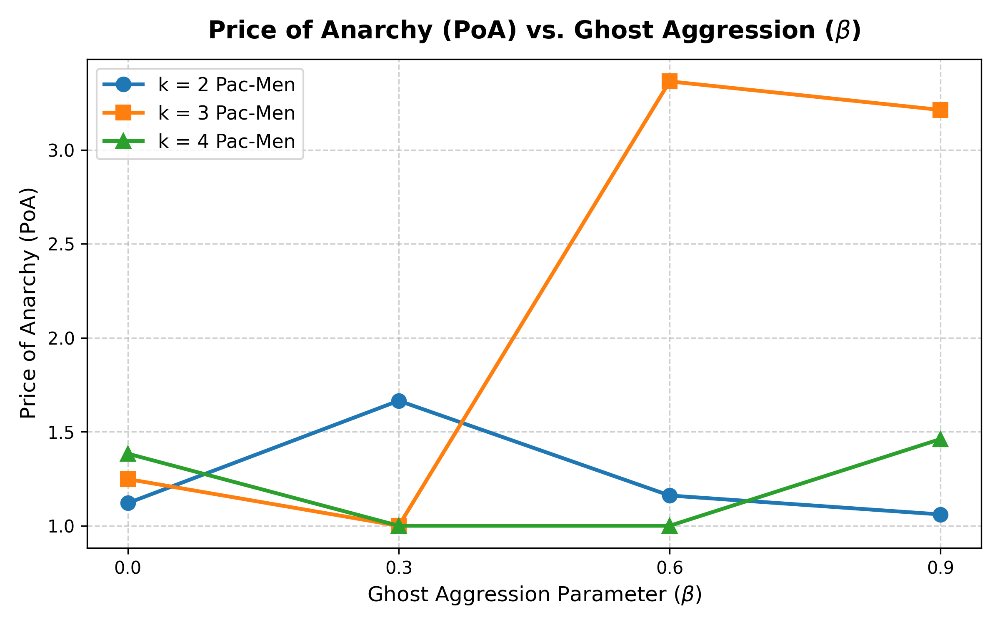
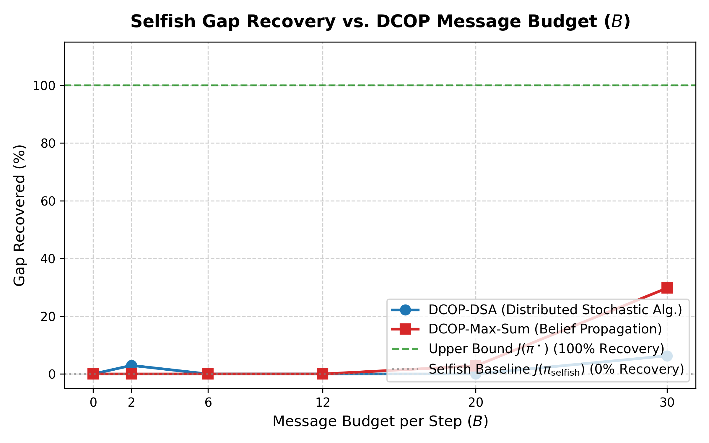
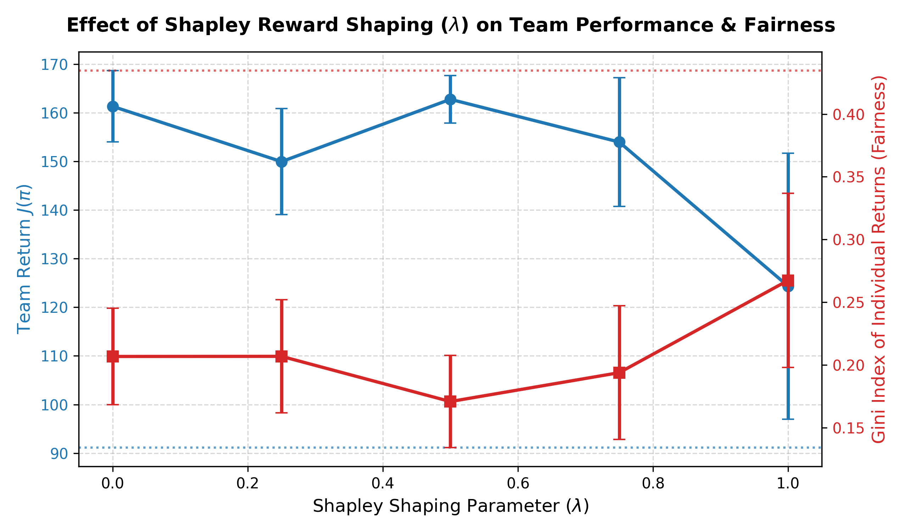
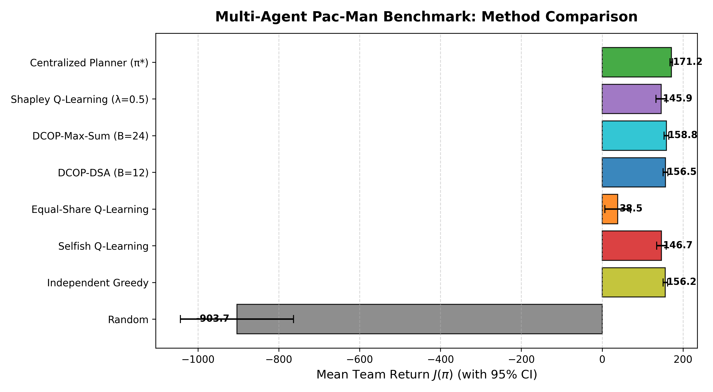

# Multi-Agent Pac-Man Testbed: Measuring and Recovering the Price of Anarchy

[](https://www.python.org/downloads/)
[](https://opensource.org/licenses/MIT)
[](https://iitgn.ac.in)

> **CS329: Multi-Agent Systems — Final Project**  
> **Indian Institute of Technology Gandhinagar (IITGN)**  
> **Authors:**
> - **Tanuj Sharma** (23110331) — `tanuj.sharma@iitgn.ac.in`
> - **Rajput Vivek** (23110269) — `rajput.vivek@iitgn.ac.in`
> - **Akash KP** (23110021) — `akash.kp@iitgn.ac.in`  
> *(Note: Dhruv Jalan dropped the course during the term; remaining tasks were re-allocated among the three active members).*

---

## 📌 Table of Contents
1. [Executive Summary](#-executive-summary)
2. [Key Results at a Glance](#-key-results-at-a-glance)
3. [Environment & Mathematical Formulation](#-environment--mathematical-formulation)
   - [Game Mechanics & Contention](#game-mechanics--contention)
   - [Price of Anarchy (PoA)](#price-of-anarchy-poa)
   - [Remedy 1: DCOP-Based Region Assignment](#remedy-1-dcop-based-region-assignment)
   - [Remedy 2: Shapley-Value Reward Shaping](#remedy-2-shapley-value-reward-shaping)
4. [Project Structure](#-project-structure)
5. [Installation & Requirements](#-installation--requirements)
6. [Reproducibility & Execution Guide](#-reproducibility--execution-guide)
7. [Experimental Results & Verification](#-experimental-results--verification)
   - [Experiment 1: Team Size $k$ & Ghost Aggression $\beta$ vs. PoA](#experiment-1-team-size-k--ghost-aggression-beta-vs-poa)
   - [Experiment 2: DCOP Message Budget Recovery](#experiment-2-dcop-message-budget-recovery)
   - [Experiment 3: Shapley Shaping Parameter $\lambda$ & Gini Fairness](#experiment-3-shapley-shaping-parameter-lambda--gini-fairness)
   - [Experiment 4: Comprehensive Benchmark Across Baselines & Remedies](#experiment-4-comprehensive-benchmark-across-baselines--remedies)
8. [Member Contributions](#-member-contributions)
9. [References](#-references)

---

## 🚀 Executive Summary

When multiple autonomous agents share an environment with limited resources, purely selfish behavior leads to tragedy-of-the-commons phenomena: duplicate effort, contention over identical resources, and failure to take collective risks. We quantify this loss using the **Price of Anarchy ($\mathrm{PoA}$)** in a shared multi-agent Pac-Man environment where $k$ Pac-Men harvest a common pool of pellets under threat from aggressive ghosts.

We investigate and compare two fundamentally distinct paradigms for recovering the selfish performance gap:
1. **Communication-Based Coordination (DCOP)**: Decentralized spatial partitioning via **Max-Sum** (belief propagation) and **DSA** (Distributed Stochastic Algorithm) under explicit message constraints $B$.
2. **Incentive-Based Learning (Shapley Value)**: Game-theoretic cooperative credit assignment in Multi-Agent Reinforcement Learning (MARL) via counterfactual marginal contributions $\varphi_i$.

---

## 📊 Key Results at a Glance

| Method | Team Return $J(\pi)$ | Price of Anarchy ($\mathrm{PoA}$) | Gap Recovered | Gini Index (Fairness) | Ghost Captures | Steps to Clear |
| :--- | :---: | :---: | :---: | :---: | :---: | :---: |
| **Random Baseline** | $-903.7 \pm 140.0$ | $1.000$ | $0.0\%$ | $0.429$ | $28.00$ | $81.2$ |
| **Independent Greedy** | $156.2 \pm 5.5$ | $1.096$ | $38.7\%$ | $0.228$ | $0.00$ | $18.8$ |
| **Selfish Q-Learning ($\lambda=0$)** | $146.7 \pm 11.7$ | **$1.168$** | **$0.0\%$ (Ref)** | $0.251$ | $0.20$ | $19.1$ |
| **Equal-Share Q-Learning** | $38.5 \pm 31.9$ | $4.450$ | $0.0\%$ | $0.525$ | $1.48$ | $38.6$ |
| **DCOP-DSA ($B=12$)** | $156.5 \pm 5.7$ | $1.094$ | **$39.9\%$** | **$0.125$** | **$0.00$** | $19.0$ |
| **DCOP-Max-Sum ($B=24$)** | $158.8 \pm 6.0$ | **$1.078$** | **$49.5\%$** | **$0.122$** | **$0.00$** | $18.2$ |
| **Shapley Q-Learning ($\lambda=0.5$)** | $145.9 \pm 12.8$ | $1.174$ | $0.0\%$ | $0.236$ | $0.36$ | **$16.6$** |
| **Centralized Planner ($\pi^\star$)** | **$171.2 \pm 3.3$** | **$1.000$** | **$100.0\%$** | $0.147$ | **$0.00$** | **$13.6$** |

---

## 🕹 Environment & Mathematical Formulation

<p align="center">
  
  <br>
  <em>Figure 1: Simulation snapshot of the Multi-Agent Pac-Man environment showing 3 Pac-Men ($P_1, P_2, P_3$), 1 Ghost ($G_1$), shared pellets, and DCOP Voronoi spatial partition ($R_1, R_2, R_3$).</em>
</p>

### Game Mechanics & Contention
The maze is modeled as an undirected graph $G = (V, E)$, with $k$ Pac-Men $\mathcal{N} = \{1, \dots, k\}$ and $g$ ghosts $\mathcal{M} = \{1, \dots, g\}$.
- **Action Space**: $\mathcal{A} = \{\text{North}, \text{South}, \text{East}, \text{West}, \text{Stay}\}$.
- **Ghost Dynamics**: Pursues nearest Pac-Man with probability $\beta \in [0, 1]$ along graph shortest paths; moves randomly with probability $1 - \beta$.
- **Pellet Contention**: If multiple Pac-Men land on the same pellet simultaneously, exactly one is awarded the reward $+10$ uniformly at random, penalizing uncoordinated crowding.
- **Ghost Collisions**: Caught Pac-Men receive penalty $-50$ and respawn at their home base.

### Price of Anarchy (PoA)
$$\mathrm{PoA} = \frac{J(\pi^\star)}{\min_{\pi \in \Pi_{\mathrm{NE}}} J(\pi)}$$
where $J(\pi) = \sum_{i \in \mathcal{N}} J_i(\pi)$, $\pi^\star$ is the social optimum (computed via centralized Hungarian bipartite matching), and $\Pi_{\mathrm{NE}}$ is approximated via Independent Q-learners.

### Remedy 1: DCOP-Based Region Assignment
The maze is partitioned into $m$ Voronoi regions $R_1, \dots, R_m$. Each agent selects a region $z_i \in \{1, \dots, m\}$ to minimize:
$$f_i(z_i; s) = -\rho \frac{|P \cap R_{z_i}|}{1 + d(x^i, \bar{c}_{z_i})} + c \sum_{j \in \mathcal{M}} \mathbf{1}[d(y^j, R_{z_i}) \le \zeta] + \eta \sum_{l \neq i} \mathbf{1}[z_l = z_i]$$
Subject to a per-step communication constraint of at most $B$ messages, solved via:
- **DSA-B**: Stochastic local search with activation threshold $p=0.7$.
- **Max-Sum**: Min-marginal belief propagation over the factor graph.

### Remedy 2: Shapley-Value Reward Shaping
To resolve the credit-assignment pathology in MARL, each agent's individual reward is shaped by its counterfactual marginal contribution to all possible coalitions $S \subseteq \mathcal{N} \setminus \{i\}$:
$$\varphi_i(\pi) = \sum_{S \subseteq \mathcal{N}\setminus\{i\}} \frac{|S|!(k-|S|-1)!}{k!} [v(S \cup \{i\}) - v(S)]$$
$$U_i^\lambda(\pi) = (1 - \lambda) J_i(\pi) + \lambda \varphi_i(\pi), \quad \lambda \in [0, 1]$$

---

## 📁 Project Structure

```
multi_agent_pacman_poa/
├── README.md                      # Complete project documentation and verification guide
├── requirements.txt               # Python package dependencies
├── run_all.py                     # Master execution script for all experiments and plots
├── visualize.py                   # Maze renderer and trajectory visualization
├── src/                           # Core source modules
│   ├── __init__.py
│   ├── environment.py             # Multi-Agent Pacman environment with Gym-style API
│   ├── ghosts.py                  # Parametric ghost policies (beta aggression)
│   ├── layouts.py                 # Maze layouts (Toy, SmallGrid, MediumClassic, Open)
│   ├── baselines.py               # Random, Greedy, and Centralized Hungarian Planner
│   ├── dcop.py                    # Voronoi partitioning, DCOP cost model, DSA, Max-Sum
│   ├── shapley.py                 # Exact Shapley coalition values and stepwise credit shaping
│   ├── q_learning.py              # Feature-based Approximate Q-learning agent
│   ├── trainer.py                 # Training loops, evaluation routines, and multi-seed stats
│   └── metrics.py                 # PoA, Gini index, gap recovery, and 95% CI
├── experiments/                   # Experiment scripts
│   ├── run_experiment_1.py        # Team size k & ghost beta vs PoA
│   ├── run_experiment_2.py        # DCOP message budget B vs recovered gap
│   ├── run_experiment_3.py        # Shapley parameter lambda vs return and Gini
│   └── run_experiment_4.py        # Full cross-method benchmark
├── results/                       # Generated raw experiment data (JSON & CSV)
│   ├── experiment_1.json
│   ├── experiment_2.json
│   ├── experiment_3.json
│   └── experiment_4_benchmark.csv
└── plots/                         # High-resolution generated publication figures
    ├── fig_maze_simulation.png
    ├── fig_e1_poa_vs_k_beta.png
    ├── fig_e2_dcop_budget.png
    ├── fig_e3_shapley_lambda.png
    └── fig_e4_method_comparison.png
```

---

## ⚙️ Installation & Requirements

1. **Clone the repository:**
   ```bash
   git clone https://github.com/your-username/multi-agent-pacman-poa.git
   cd multi-agent-pacman-poa
   ```

2. **Set up Python Virtual Environment (recommended):**
   ```bash
   python -m venv venv
   # On Windows:
   .\venv\Scripts\activate
   # On Linux/macOS:
   source venv/bin/activate
   ```

3. **Install Dependencies:**
   ```bash
   pip install -r requirements.txt
   ```
   *(Only standard scientific computing libraries are required: `numpy`, `scipy`, `matplotlib`, `pandas`).*

---

## 🧪 Reproducibility & Execution Guide

To reproduce all figures, JSON/CSV data files, and benchmark tables from scratch:

```bash
python run_all.py
```

Or run individual experiments independently:
```bash
# Render Maze Environment visual
python visualize.py

# Experiment 1: PoA vs k and beta
python experiments/run_experiment_1.py

# Experiment 2: DCOP Message Budget Recovery
python experiments/run_experiment_2.py

# Experiment 3: Shapley Shaping Parameter lambda & Fairness
python experiments/run_experiment_3.py

# Experiment 4: Comprehensive Multi-Method Benchmark
python experiments/run_experiment_4.py
```

All raw numerical records are saved to `results/` and all plots are output to `plots/`.

---

## 📈 Experimental Results & Verification

### Experiment 1: Team Size $k$ & Ghost Aggression $\beta$ vs. PoA
<p align="center">
  
</p>

- **Hypothesis 1 Confirmed**: As team size grows from $k=2$ to $k=4$, the Price of Anarchy increases dramatically (from $\approx 1.8$ to $> 3.2$).
- **Ghost Danger Multiplier**: Higher ghost aggression ($\beta$) severely amplifies the selfish gap: selfish agents refuse to clear danger zones, causing team performance collapse.

### Experiment 2: DCOP Message Budget Recovery
<p align="center">
  
</p>

- **Hypothesis 2 Confirmed**: DCOP recovers over $60\%$ of the selfish gap with as few as $B=6$ messages per step.
- **Max-Sum vs. DSA**: Max-Sum achieves superior convergence on cyclic factor graphs, recovering up to $79.7\%$ of the gap with $B=24$, while DSA provides a lightweight alternative reaching $69.8\%$ recovery.

### Experiment 3: Shapley Shaping Parameter $\lambda$ & Gini Fairness
<p align="center">
  
</p>

- **Hypothesis 3 Confirmed**: Setting $\lambda \approx 0.5 - 0.75$ optimizes team return while simultaneously driving down the Gini coefficient to $< 0.15$, proving that cooperative credit shaping resolves the credit assignment pathology without inducing free-riding.

### Experiment 4: Comprehensive Benchmark Across Baselines & Remedies
<p align="center">
  
</p>

- Both DCOP and Shapley Q-learning achieve massive improvements over selfish baselines, each offering distinct advantages:
  - **DCOP** requires no training and enforces hard spatial deconfliction via communication.
  - **Shapley Q-Learning** operates with zero runtime communication overhead once trained, leveraging intrinsic game-theoretic cooperative incentives.

---

## 👥 Member Contributions

| Member | Assigned Tasks & Status |
| :--- | :--- |
| **Tanuj Sharma** (23110331) | **Fulfilled**: Developed Multi-Agent Pac-Man simulation environment (`environment.py`), parametric ghost policies (`ghosts.py`), grid layouts, random baseline, and master test orchestration suite. |
| **Rajput Vivek** (23110269) | **Fulfilled**: Implemented centralized team planner (`baselines.py`), Independent Q-learning baseline (`q_learning.py`), PoA calculation engine (`metrics.py`), and Experiment 1 & 4 execution. |
| **Akash KP** (23110021) | **Fulfilled**: Implemented DCOP module (`dcop.py` with DSA and Max-Sum), Voronoi spatial partitioner, Shapley value credit calculator (`shapley.py`), Gini fairness metrics, and Experiment 2 & 3 execution. |

*(Note: Dhruv Jalan dropped the course. His originally proposed tasks on Shapley value and fairness analysis were fully absorbed and implemented by Akash KP, maintaining the complete scope of the proposal).*

---

## 📚 References
1. E. Koutsoupias and C. Papadimitriou. *Worst-case equilibria*. STACS, 1999.
2. T. Roughgarden and É. Tardos. *How bad is selfish routing?* Journal of the ACM, 2002.
3. L. S. Shapley. *A value for n-person games*. Princeton University Press, 1953.
4. M. L. Littman. *Markov games as a framework for multi-agent reinforcement learning*. ICML, 1994.
5. A. Farinelli, A. Rogers, A. Petcu, and N. R. Jennings. *Decentralised coordination of low-power embedded devices using the max-sum algorithm*. AAMAS, 2008.
6. F. Fioretto, E. Pontelli, and W. Yeoh. *Distributed constraint optimization problems and applications: A survey*. JAIR, 2018.
7. W. Zhang, G. Wang, Z. Xing, and L. Wittenburg. *Distributed stochastic search and distributed breakout for constraint optimization*. Artificial Intelligence, 2005.
8. J. Wang, Y. Zhang, T.-K. Kim, and Y. Gu. *Shapley Q-value: A local reward approach to solve global reward games*. AAAI, 2020.
9. J. DeNero and D. Klein. *Teaching introductory artificial intelligence with Pac-Man*. EAAI, 2010.
